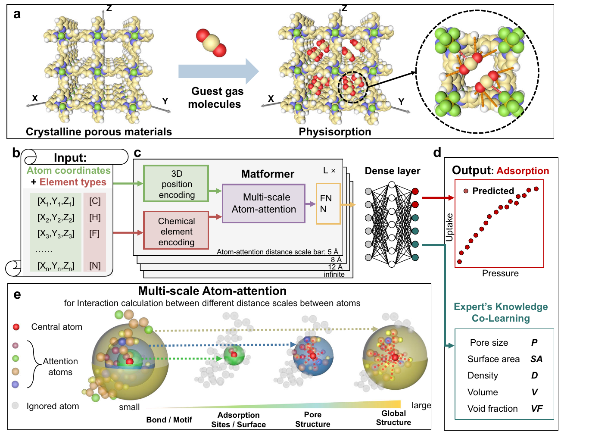
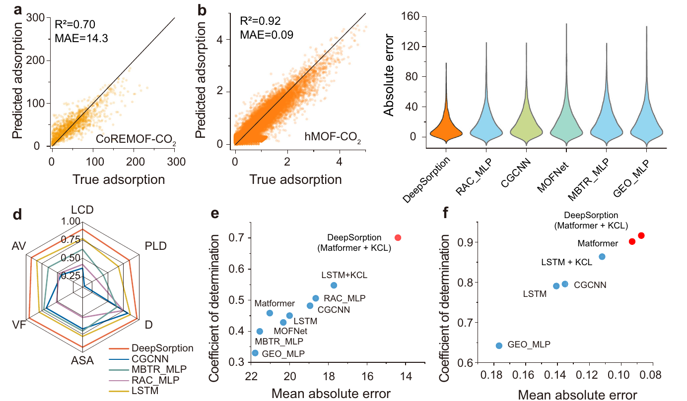
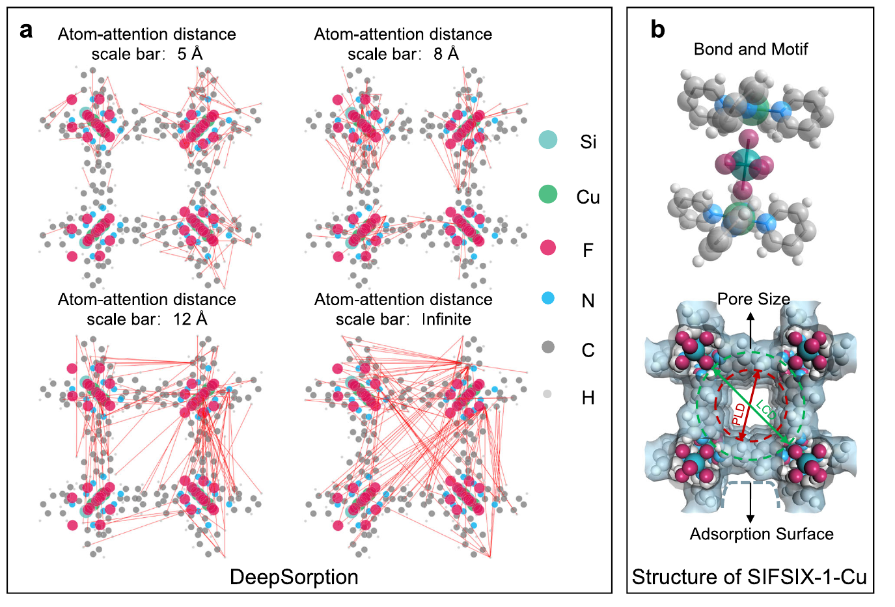

# DeepSorption

This repository contains the official implementation of **DeepSorption**, a deep learning framework for predicting adsorption-related properties of metal-organic frameworks (MOFs).

The code includes training and prediction examples for CoRE-MOF, hMOF, and EXPMOF datasets, together with utilities for molecular representation learning and 3D attention visualization.

## Associated Paper

This repository accompanies the Nature Communications paper **"Direct prediction of gas adsorption via spatial atom interaction learning"**:

https://doi.org/10.1038/s41467-023-42863-6

The figures below are extracted from the associated paper to provide a quick visual overview of the method, benchmarks, and interpretability analysis.

## Overview

<p align="center">
  
</p>

DeepSorption takes atomic coordinates and element types as direct inputs, learns spatial atom interactions through the Matformer architecture, and predicts adsorption properties without relying only on hand-crafted descriptors.

## Results at a Glance

<p align="center">
  
</p>

DeepSorption shows strong prediction performance on CoRE-MOF and hMOF benchmarks and is compared against descriptor-based machine learning models, graph neural networks, and other deep learning baselines.

## Attention Visualization

<p align="center">
  
</p>

The attention visualization highlights atom-pair interactions at multiple distance scales, offering an interpretable view of how the model captures local motifs, pore environments, and global structure.

## Requirements

DeepSorption was developed with the following environment:

```text
python          3.7
matplotlib      3.5.1
numpy           1.21.2
pandas          1.3.4
scikit-learn    0.22.1
torch           1.7.1
tqdm            4.42.1
mendeleev       0.9.0
pymatgen
```

Several scripts use CUDA directly, so a CUDA-enabled GPU is recommended for training and evaluation.

## Dataset

Raw and preprocessed materials science datasets are available on Zenodo:

https://doi.org/10.5281/zenodo.7699719

After downloading the data, place the processed files under `pre_data/` and the trained checkpoints or generated outputs under `save/`. The scripts in `train_and_predict/` assume this directory layout:

```text
DeepSorption1.0/
|-- pre_data/
|   |-- coremof/
|   |-- c2h2/
|   `-- co2/
|-- save/
|   |-- coremof/
|   |-- expmof/
|   `-- hmof/
`-- train_and_predict/
```

## Quick Start

To run the examples below, first enter the training and prediction directory:

```bash
cd train_and_predict
```

### Use a Trained CoRE-MOF Model

To evaluate a trained DeepSorption model on the CoRE-MOF dataset, run:

```bash
python CoREMOF/pred.py
```

This script loads the preprocessed CoRE-MOF data, runs prediction, and saves the labels and predictions for the training, validation, and test splits:

```text
save/coremof/COREMOF_train.npy
save/coremof/COREMOF_dev.npy
save/coremof/COREMOF_test.npy
```

The evaluation usually takes about two minutes, depending on the hardware.

### Train on CoRE-MOF

To train DeepSorption on the CoRE-MOF dataset, run:

```bash
python CoREMOF/main.py
```

### Evaluate on CoRE-MOF

To test model performance on the CoRE-MOF dataset, run:

```bash
python CoREMOF/pred.py
```

### Train and Test on EXPMOF

To run leave-one-out experiments on the EXPMOF datasets, use:

```bash
python EXPMOF/leave_one_out.py --expmof c2h2
```

or:

```bash
python EXPMOF/leave_one_out.py --expmof co2
```

Use the `--expmof` argument to select the target EXPMOF dataset.

## 3D Attention Visualization

Example CIF files and rendered attention visualizations are provided in:

```text
3D_attention_visualization/
```

The included notebook and example HTML files can be used to inspect how the model attends to 3D structural environments.

## Repository Structure

```text
DeepSorption1.0/
|-- 3D_attention_visualization/   # Example CIF files and attention visualization outputs
|-- initial/                      # Pretraining and initialization utilities
|-- LSTM/                         # LSTM baseline-related scripts
|-- Matformer/                    # Transformer model components
|-- train_and_predict/            # Training and prediction scripts
`-- utils/                        # Shared utilities
```
